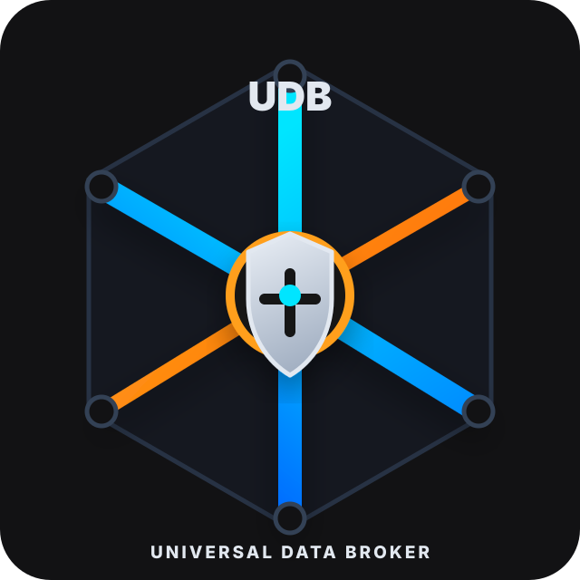

# UDB Python SDK

<!-- UDB_BRAND_HEADER_START -->
<p align="center">
  
</p>

<p align="center">
  <strong>UDB :: Universal Data Broker</strong><br>
  <sub>gRPC data plane | native control plane | tenant/project scope guard<br>crate v0.6.17 | protocol v1.0.0</sub>
</p>
<!-- UDB_BRAND_HEADER_END -->

`udb-client` is the Python client for UDB. It gives you sync and async clients,
metadata handling, common CRUD helpers, optional Pydantic models, raw access to
every broker RPC, and a version-matched `udb` CLI launcher.

## Install

```bash
pip install udb-client==0.6.17
```

Optional validated command models:

```bash
pip install "udb-client[pydantic]==0.6.17"
```

Runtime: Python 3.10+


## Typed Tables For Your Own Protos

Generate typed code from the protos your project owns. Go, TypeScript and Python
produce the same parts:

```bash
udb sdk generate --project-proto ./proto --lang python --out ./gen --entities-only
udb sdk diff --project-proto ./proto --against ./gen/python/udb_entities_gen.py # for CI
```

For each table, `gen/python/udb_entities_gen.py` provides the `X` row TypedDict, `XKey`
and `XBy<Unique>` key types, `XFields`, the `XColumns` column policy, `XWhere` typed
predicates, the `XToUDBRecord` and `XFromUDBRow` mappers, `XTable(project)` and
`XRepo(project)`.

```python
from gen.python.udb_entities_gen import InvoiceTable, InvoiceWhere
from udb_client.exceptions import UdbConflict, UdbNotFound

invoices = InvoiceTable(project)  # a UdbProject

invoices.insert({"invoice_id": invoice_id, "tenant_id": tenant_id, "amount_cents": 1200})
invoices.upsert({"invoice_id": invoice_id, "amount_cents": 1300})
invoice = invoices.get({"invoice_id": invoice_id})  # raises UdbNotFound when absent

invoices.patch({"invoice_id": invoice_id}, {"paid_at": "2031-02-03T04:05:06Z"})
invoices.patch({"invoice_id": invoice_id}, {"paid_at": None})  # clears the column
invoices.increment({"invoice_id": invoice_id}, {"retries": 1})  # atomic on the broker

# A compare-and-swap, and the same with the read and the retry handled for you.
invoices.update_if(
    {"invoice_id": invoice_id, "status": "INVOICE_STATUS_PAID"},
    {"status": "INVOICE_STATUS_OPEN"},
)
invoices.update_with_retry(
    {"invoice_id": invoice_id},
    lambda row: {**row, "retries": row.get("retries", 0) + 1},
)

page = invoices.select(
    InvoiceWhere.amount_cents.gte(1000),
    order_by=["-amount_cents"],
    limit=50,
    include_total=True,
)
invoices.select_all(InvoiceWhere.paid_at.is_null(), lambda row: print(row["invoice_id"]))
unpaid = invoices.count(InvoiceWhere.paid_at.is_null())
invoices.delete({"invoice_id": invoice_id})
```

- Rows are dicts keyed by proto field name. A JSON or JSONB value is passed through
  unchanged, nested keys included.
- A column that is NULL is an absent key. Match it with `InvoiceWhere.paid_at.is_null()`;
  a filter of `{"paid_at": None}` is refused.
- A text-stored enum uses its full value name, such as `INVOICE_STATUS_OPEN`.
- A column the table does not have is refused, never silently dropped.
- `get` and `select` leave PII columns out by default. If you hold `udb:pii:read`,
  pass `include_pii=True` to read them.
- A missing row raises `UdbNotFound` and a lost compare-and-swap raises `UdbConflict`.
  `XRepo(project).get` returns `None` instead, and its `update_guarded` and
  `delete_guarded` refuse an empty precondition.
- Two messages with the same short name in one `--project-proto` directory are
  refused, because their generated names would collide. A table with no primary key
  gets its row type and mappers, but no `XTable` or `XRepo`.

## Export UDB Protos For Your App

After installation, the `udb` command is available. Use it from your app project
to copy UDB's annotation and broker protos into your own proto tree:

```bash
udb proto export --fmt
```

Then your project schemas can import:

```proto
import "udb/core/common/v1/db.proto";
```

Run `udb proto export` again whenever you upgrade the SDK/CLI. It keeps the UDB
annotation protos and your installed CLI version together.

Run `udb proto fmt` after export or schema edits to keep long UDB field
annotations on one line for easier review.

## Basic CRUD

```python
from udb_client import Metadata, UdbClient, decode_records

meta = Metadata(
    tenant_id="acme",
    user_id="user-1",
    purpose="billing.api",
    correlation_id="request-001",
    scopes=("udb:read", "udb:write"),
    service_identity="billing-service",
    project_id="billing",
)

with UdbClient("127.0.0.1:50051", meta) as udb:
    udb.upsert(
        message_type="acme.billing.v1.Customer",
        record={
            "customer_id": "cus_001",
            "tenant_id": "acme",
            "name": "Ada Lovelace",
            "email": "ada@example.com",
        },
        conflict_fields=("customer_id",),
        return_record=True,
    )

    rows = udb.select(
        message_type="acme.billing.v1.Customer",
        filter={"customer_id": "cus_001"},
        limit=1,
    )
    print(decode_records(rows))
```

## Async

```python
from udb_client import Metadata, UdbAsyncClient

meta = Metadata(
    tenant_id="acme",
    purpose="billing.worker",
    correlation_id="job-42",
    scopes=("udb:read", "udb:write"),
    service_identity="billing-worker",
    project_id="billing",
)

async with UdbAsyncClient("127.0.0.1:50051", meta) as udb:
    await udb.upsert(
        message_type="acme.billing.v1.Customer",
        record={"customer_id": "cus_002", "tenant_id": "acme"},
        conflict_fields=("customer_id",),
    )
```

The async client is faster under concurrency than the sync client (it shares one
HTTP/2 channel across many in-flight coroutines), so prefer `UdbAsyncClient` /
`UdbAsyncProject` (`create_udb_async`) for high-throughput or fan-out workloads.

## File Storage

`UdbProject` exposes the `StorageService` file lifecycle on `project.storage`.
The one-call `upload_file` does `RegisterUpload` → HTTP PUT the bytes to the
presigned URL → `FinalizeUpload` (exactly three RPCs, no proof Get/List):

```python
from udb_client import UdbConfig, UdbProject

with UdbProject.connect(
    UdbConfig(target="127.0.0.1:50051", tenant_id="acme", project_id="default")
) as project:
    project.login_and_adopt_tenant("svc@acme", "password")  # bearer + canonical tenant

    finalized = project.storage.upload_file(
        "report.pdf",
        b"...file bytes...",
        {"content_type": "application/pdf", "file_type": "report"},
    )
    file_id = finalized.file_id
```

### Download

Downloads prefer the presigned `GetDownloadUrl` path so file bytes never travel
through the broker. `download_file` returns the `GetDownloadUrlResponse` by
default; pass `fetch=True` to also HTTP GET the presigned URL and return the raw
bytes:

```python
# Presigned URL only (default): no bytes through the broker
resp = project.storage.download_file(file_id)
print(resp.download_url)

# Resolve the presigned URL and HTTP GET the bytes back
data = project.storage.download_file(file_id, fetch=True)
```

New in 0.3.6: when a client cannot egress to the object store (no public
download URL, corporate proxy, etc.), stream the bytes **through the broker**
with the server-streaming `StorageService.DownloadFile` RPC. Pass `stream=True`
to `download_file`, or call `download_stream` directly — both issue exactly one
`DownloadFile` RPC and reassemble every `DownloadFileChunk` into the full body:

```python
# Server-streaming fallback through the broker
data = project.storage.download_file(file_id, stream=True)
# equivalently:
data = project.storage.download_stream(file_id)
```

## Performance

Every UDB client holds a **single long-lived gRPC channel** — construct the
client once and reuse it across all RPCs (the `with`/`async with` block above keeps
it open for its body). Never create a client per call: a fresh channel forces a
TCP+TLS+HTTP/2 handshake every time, which dominates per-RPC latency.

By default the channel is built with `udb_client.default_channel_options()`, which adds:

- **Keepalive** (`keepalive_time_ms=30000`, `keepalive_timeout_ms=10000`,
  `keepalive_permit_without_calls=1`) so an idle connection stays warm instead of
  dropping to IDLE and re-handshaking.
- No channel-wide retry policy. Generated wrappers retry only read-only unary RPCs
  using proto-derived `operation_kind`; mutating RPCs are never replayed by default.

Pass your own `channel_options=` to override any of these (your options win on
conflicting keys); `merge_channel_options(...)` is exposed if you want to layer
yours on top of the defaults yourself.

## Production Connections

`connect_enterprise` logs in, verifies the bearer, adopts the canonical tenant UUID, and
keeps the bearer current in the background. A refresh token the broker refuses leads to
a fresh login; a renewal that verifies as a different principal poisons the session, and
later calls are refused locally with `UNAUTHENTICATED`.

```python
from udb_client import connect_enterprise

session = connect_enterprise(
    target="broker:50051",
    auth_target="broker:50061",
    username="ops",
    password=password,
    tenant_code="acme",  # a hint only
)
session.validate_tenant(record["tenant_id"])  # raises UdbTenantError on a mismatch
session.data.select(message_type="acme.v1.Invoice", filter={"tenant_id": session.canonical_tenant_id})
session.close()
```

A service with an API key reads one environment contract. Every missing or invalid
variable is reported at once, and the verified principal is checked at connect:

```python
from udb_client import Expect, connect_from_env

# UDB_TARGET, UDB_TENANT_ID, UDB_PURPOSE, UDB_API_KEY (see udb_client.connect_env)
project = connect_from_env(expect=Expect(required_scopes=["udb:read"]))
project.ready()  # readiness probe: broker health plus credential state
project.bearer_expires_at()
```

A private CA and mutual TLS (for example nginx with `ssl_verify_client on`) come
from `UDB_TLS_CA_FILE` (PEM bundle to trust instead of the system roots) and
`UDB_TLS_CERT_FILE` + `UDB_TLS_KEY_FILE` (client certificate chain and key, set
both or neither). Any of them turns TLS on; an unreadable file is an error naming
the variable and path. In code, the same PEMs go on `UdbConfig` (and
`EnterpriseConfig`, `UdbClient`, `UdbAuthClient`):

```python
from pathlib import Path
from udb_client import UdbConfig, UdbProject

project = UdbProject(UdbConfig(
    target="udb.example.com:443",
    tls=True,
    root_certificates=Path("/etc/udb/ca.pem").read_bytes(),
    client_certificate_chain=Path("/etc/udb/client.pem").read_bytes(),
    client_private_key=Path("/etc/udb/client.key").read_bytes(),  # both or neither
))
```

A service serving several tenants keeps one client per tenant:

```python
from udb_client import UdbConfig, api_key_tenant_pool

pool = api_key_tenant_pool(UdbConfig(target="broker:50051"), {tenant_uuid: api_key})
project = pool.get(tenant_uuid)  # replaced automatically when its credential stops refreshing
```

To call as an end user, pass `as_user` metadata. The broker verifies the bearer, and the
connected tenant and project do not change:

```python
files = project.storage.list_files(metadata=project.as_user(user_bearer))
user = project.auth.validate_session(user_bearer)
```

## Live Queries, Graph, Vector, Flags, Migrations

```python
from udb_client import lq_eq, UdbNoDeltaFeed

# A message class decodes rows; a full type name gives dicts. Reconnects and resumes itself.
query = project.live_query(Note, where=[lq_eq("owner", me)])
try:
    for event in query:
        if event.is_snapshot:
            view = {row.note_id: row for row in event.snapshot}
        else:
            view[event.row.note_id] = event.row
except UdbNoDeltaFeed:
    ...  # the broker has no CDC change feed: the snapshot is all there is

rows = project.graph_from(Note, note_id).out("RELATED").depth(1, 2).run()
hits = project.vectors_hybrid("notes", Note).text("rotate keys").near(embedding).limit(10).run()

project.flags.enabled("new-editor", {"user_id": me})  # a flag that does not exist is off
project.admin.apply_current(project_id)  # plan, approve, apply
project.storage.delete_file_mode(file_id, DELETE_MODE_HARD, reason="gdpr")
project.generated.LockService.get_lock(request)  # every RPC the facades do not cover
```

`UdbAsyncProject` has awaited forms of `ready`, `as_user`, `flags`, `admin`, `live_query`
(`async for`), `graph_from` and `vectors_hybrid`. `connect_enterprise_async` and
`connect_from_env_async` return one, with the credential owned by a synchronous client
that stays reachable as `credential_owner`. A tenant pool is synchronous because async
channels belong to one event loop: use `await asyncio.to_thread(pool.get, tenant)` and
`UdbAsyncProject.from_project(project, owns=False)`. `generated` is synchronous only.

A gRPC server can lift the UDB request context off inbound metadata:

```python
from udb_client.adapters import UdbServerInterceptor, metadata_from_context

server = grpc.server(pool, interceptors=[UdbServerInterceptor()])
# in a handler: metadata_from_context().tenant_id
```

Schema reflection reads the proto annotations: `topic`, `unique_keys`, `max_len`,
`apply_column_defaults`, `owner_columns`, `retention_class`, `soft_delete` and
`graph_label` take a generated message class or instance.

## Authz Check

```python
from udb_client.auth import UdbAuthClient
from udb.core.authz.services.v1 import core_pb2 as authz

with UdbAuthClient("127.0.0.1:50051", meta) as auth:
    allowed, decision = auth.can(
        authz.ResourceRef(message_type="acme.billing.v1.Customer"),
        "read",
    )
```

`can` and `check_access` decide for the caller. A service account that needs a
user's answer holds the scope `udb:authz:check-access-for` and names the user;
see [Service accounts acting for users](../../docs/service-accounts.md).

## Consistency, Idempotency Replay, And Typed Errors

A mutation returns a `WriteReceipt`; a follow-up read can carry a read fence
built from it, or request an explicit consistency mode. A keyed replay-safe
mutation the broker deduplicated reports `was_duplicate` (full contract:
[docs/native-services.md](../../docs/native-services.md)).

```python
from udb_client import ConsistencyMode, was_duplicate

resp, receipt = udb.upsert_with_receipt(
    message_type="acme.billing.v1.Invoice",
    record={"invoice_id": "inv-1", "total_cents": 100},
    conflict_fields=("invoice_id",),
    idempotency_key="inv-1-create",
)
if was_duplicate(resp):
    ...  # broker replayed a prior identical keyed write

# Read-your-writes: metadata carrying a fence derived from the receipt.
fenced = meta.after_write(receipt)
rows = udb.select(message_type="acme.billing.v1.Invoice", metadata=fenced)

# Or pin a typed consistency mode (strong / read-your-writes / bounded / eventual …).
eventual = meta.with_consistency(ConsistencyMode.EVENTUAL)
```

Retry contract: a replay-safe mutation is retried on transient errors **only
when the request carries a non-empty `idempotency_key`** — keyless mutations
fail closed rather than risk a double apply. Typed error details decode from
the `udb-error-detail-bin` trailer onto `UdbDetailedError`
(`kind` / `retryable` / `field_violations`).

## Platform Services (Vault, Metering, Scheduler, …)

Vault, Metering, Scheduler, Search, Webhook, Workflow, Lock, LiveQuery, Config,
Backup, and Embedding have no workflow facade yet — call them through the
generated per-service robustness clients (native services ride the native
listener when your deployment separates it):

```python
from udb_client.generated_client import GeneratedClient
from udb.core.vault.services.v1 import vault_service_pb2 as vault

gen = GeneratedClient("127.0.0.1:50051", meta)
key = gen.VaultService.create_transit_key(
    vault.CreateTransitKeyRequest(tenant_id=tenant, key_name="docs")
)
enc = gen.VaultService.encrypt(
    vault.EncryptRequest(tenant_id=tenant, key_name="docs", plaintext="secret")
)
```

The per-RPC retry class and idempotency contract live in
[docs/generated/udb-native-contract.json](../../docs/generated/udb-native-contract.json).

## Full API Access

For broker APIs without a convenience method, use `client.call("RpcName",
request)` for unary RPCs with metadata/error handling, or `client.stub` for raw
streaming and advanced calls.

The generated protobuf modules are included for request/response types:

```python
from udb.entity.v1 import types_pb2
from udb.services.v1 import data_broker_pb2_grpc
```

## Local SDK Development

Consumers do not need this. Use it only when editing the SDK itself:

```bash
cd sdk/python
python -m pip install -e ".[dev]"
python scripts/generate_protos.py
pytest
pyrefly check
```
