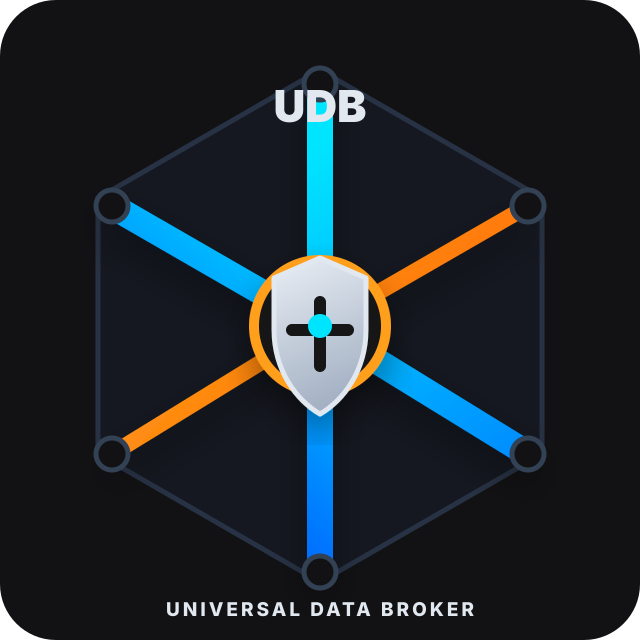

# UDB TypeScript SDK

<!-- UDB_BRAND_HEADER_START -->
<p align="center">
  
</p>

<p align="center">
  <strong>UDB :: Universal Data Broker</strong><br>
  <sub>gRPC data plane | native control plane | tenant/project scope guard<br>crate v0.6.10 | protocol v1.0.0</sub>
</p>
<!-- UDB_BRAND_HEADER_END -->

`@udb_plus/sdk` is the Node.js client for UDB. Use it when a TypeScript service
needs to read or write through the broker, call UDB auth/authz, or run the
version-matched `udb` CLI from a project that installed the package.

## Install

```bash
npm i @udb_plus/sdk@0.6.10
```

Runtime: Node 18+

Main entry points:

- `@udb_plus/sdk/client` for the DataBroker client and metadata helper
- `@udb_plus/sdk/auth` for auth/authz convenience methods
- `@udb_plus/sdk` for the full public surface

## Export UDB Protos For Your App

If your app owns `.proto` schemas and wants to use UDB annotations, export the
shared UDB protos into your project:

```bash
npx udb proto export --fmt
```

Then your app protos can import:

```proto
import "udb/core/common/v1/db.proto";
```

`proto export` is safe to re-run. It refreshes `proto/udb/**`, vendors the
`google/api/**` protos needed for offline generation, and can merge `buf.yaml`
without replacing your own settings.

Run `npx udb proto fmt` any time after export or edits to keep long UDB field
annotations on one line for easier review.

## Connect And Query

```ts
import { dataBrokerClient, metadata, UdbMetadata } from "@udb_plus/sdk/client";
import { UdbAuthClient } from "@udb_plus/sdk/auth";

const meta: UdbMetadata = {
  tenantId: "acme",
  userId: "user-1",
  purpose: "web.request",
  scopes: ["udb:read", "udb:write"],
  serviceIdentity: "billing.api",
  projectId: "billing",
};

const broker = dataBrokerClient("localhost:50051");

broker.Select(
  { message_type: "acme.billing.v1.Invoice", limit: 50 },
  metadata(meta),
  (err: unknown, rs: any) => {
    if (err) throw err;
    console.log(rs?.records);
  },
);

const auth = new UdbAuthClient("localhost:50051", meta);
const [allowed, decision] = await auth.can(
  { message_type: "acme.billing.v1.Invoice" },
  "read",
);
```

## Running A Service

Connect from the environment and check who you connected as. Every missing or
invalid variable is reported in one error:

```ts
import { UdbProject } from "@udb_plus/sdk";

// UDB_TARGET, UDB_TENANT_ID, UDB_PURPOSE, UDB_API_KEY (or UDB_BEARER); optional
// UDB_AUTH_TARGET, UDB_PROJECT_ID, UDB_SCOPES, UDB_DEADLINE=10s, UDB_TLS=true, ...
const udb = await UdbProject.connectFromEnv("", {
  tenantId: process.env.UDB_TENANT_ID,
  requiredScopes: ["udb:read"],
});

await udb.ready(); // readiness probe: gRPC health plus a current credential
udb.principal(); // the verified principal
udb.bearerExpiresAt(); // when the exchanged bearer expires
```

Serving several tenants? A pool keeps one client per tenant, shares it, and replaces
one whose credential stops refreshing:

```ts
const pool = newApiKeyTenantPool({ target, purpose: "billing" }, { [tenantId]: apiKey });
const client = await pool.get(tenantId);
await pool.close();
```

A password session verifies its tenant. Use the canonical id, never the human code, in
records and filters, and check a record before writing it:

```ts
const session = await UdbProject.connectEnterprise({ target, username, password, tenantCode: "acme" });
session.validateTenant(record.tenant_id); // throws, naming both, on a mismatch
```

Call as an end user by passing `asUser` as the call options. The broker verifies the
token, and the connected tenant and project do not change:

```ts
await udb.storage.getFile({ tenant_id, file_id }, udb.asUser(userBearer));
await udb.validateSession(userBearer, udb.asUser(userBearer));
```

Feature flags, where a flag that does not exist is off:

```ts
if (await udb.flags.enabled("new-checkout", { user_id: userId })) { /* ... */ }
```

A live query keeps a view of a filter: the current rows, then every change, resuming
after reconnects. It runs until `signal` aborts, the handler throws or the broker
refuses, and it rejects with that reason. A broker with no change feed rejects with
`NoDeltaFeedError` after the snapshot:

```ts
await liveQuery(udb, "acme.v1.Order", { where: [lqEq("status", "open")], signal }, (event) => {
  if (event.isSnapshot) replace(event.snapshot);
  else apply(event.op, event.row);
});
```

Graph traversals and hybrid vector search have builders:

```ts
const rows = await graphFrom(udb, "acme.v1.Note", noteId).out("RELATED").depth(1, 2).run();
const hits = await vectorsHybrid(udb, "notes").text("rotate keys").near(embedding).limit(10).run();
```

Read a table's rules from its annotations instead of restating them: `topic`,
`eventType`, `partitionKeyField`, `primaryKeys`, `uniqueKeys`, `tenantColumn`,
`projectColumn`, `ownerColumns`, `maxLen`, `softDelete`, `retentionClass`,
`exportEligible`, `graphLabel` and `applyColumnDefaults`. Each takes the message's full
name; for your own messages pass `{ protoRoot }`.

Lift the request identity off inbound gRPC calls in your own server:

```ts
const server = new grpc.Server({ interceptors: [udbServerInterceptor] });
// In any handler, across awaits:
requestTenantId();
requestMetadata();
```

## Typed Tables For Your Own Protos

Generate typed code from the protos your project owns. Go, TypeScript and Python
produce the same parts:

```bash
udb sdk generate --project-proto ./proto --lang ts --out ./gen --entities-only
udb sdk diff --project-proto ./proto --against ./gen/typescript/udb_entities_gen.ts # for CI
```

For each table, `gen/typescript/udb_entities_gen.ts` exports:

| Name | What it is |
| --- | --- |
| `X` | The row interface |
| `XKey`, `XBy<Unique>` | The primary key and each declared unique key |
| `XFields` | Row property to proto field name |
| `XColumns` | Column policy by field name (SQL type, nullability, PII, enum tokens) |
| `XWhere` | Typed predicates |
| `XToUDBRecord`, `XFromUDBRow` | The mappers |
| `XTable(project)` | The typed table |
| `XRepo(project)` | Filter-first access with guarded writes |

```ts
import { InvoiceTable, InvoiceWhere } from "./gen/typescript/udb_entities_gen";
import { UdbConflictError, UdbNotFoundError } from "@udb_plus/sdk";

const invoices = InvoiceTable(project); // a UdbProject

await invoices.insert({ invoiceId, tenantId, amountCents: 1200 });
await invoices.upsert({ invoiceId, amountCents: 1300 });
const invoice = await invoices.get({ invoiceId }); // throws UdbNotFoundError when absent

await invoices.patch({ invoiceId }, { paidAt: "2031-02-03T04:05:06Z" });
await invoices.patch({ invoiceId }, { paidAt: null }); // clears the column
await invoices.increment({ invoiceId }, { retries: 1 }); // atomic on the broker

// A compare-and-swap, and the same with the read and the retry handled for you.
await invoices.updateIf({ invoiceId, status: "INVOICE_STATUS_PAID" }, { status: "INVOICE_STATUS_OPEN" });
await invoices.updateWithRetry({ invoiceId }, (row) => ({ ...row, retries: (row.retries ?? 0) + 1 }));

const page = await invoices.select({
  where: InvoiceWhere.amountCents.gte(1000),
  orderBy: ["-amountCents"],
  limit: 50,
  includeTotal: true,
});
await invoices.selectAll(InvoiceWhere.paidAt.isNull(), (row) => console.log(row.invoiceId));
const unpaid = await invoices.count(InvoiceWhere.paidAt.isNull());
await invoices.delete({ invoiceId });
```

- Row properties are protobuf JSON names (`amountCents`); the mappers convert to
  and from the proto field names the broker uses. A JSON or JSONB value is passed
  through unchanged, nested keys included.
- A column that is NULL is absent from the row, not `null` or a zero value. Match it
  with `InvoiceWhere.paidAt.isNull()`; a filter of `{ paidAt: null }` is refused.
- A text-stored enum uses its full value name, such as `INVOICE_STATUS_OPEN`.
- A 64-bit integer stored as `BIGINT` reads as a number when it is exact and as a
  decimal string past `Number.MAX_SAFE_INTEGER`, so it never loses digits.
- A property the table does not have is refused, never silently dropped.
- `get` and `select` leave PII columns out by default. If you hold `udb:pii:read`,
  pass `{ includePii: true }` to read them. A PII column is always optional in the
  row type.
- A missing row throws `UdbNotFoundError` and a lost compare-and-swap throws
  `UdbConflictError`. `XRepo(project).get` returns `null` instead, and its
  `updateGuarded` and `deleteGuarded` refuse an empty precondition.
- Two messages with the same short name in one `--project-proto` directory are
  refused, because their generated names would collide. A table with no primary key
  gets its row type and mappers, but no `XTable` or `XRepo`.

## Storage: Upload And Download

The `UdbProject` facade exposes the native `StorageService` file lifecycle on
`udb.storage`. `uploadFile` is a composite helper — it does `RegisterUpload`,
PUTs the bytes to the broker-minted presigned `upload_url` over plain HTTP, then
`FinalizeUpload` — and returns the `FinalizeUpload` response.

For reads, the default is a presigned download URL (no object bytes traverse the
broker). UDB 0.3.6 adds a server-streaming `StorageService.DownloadFile` RPC and
a client helper for clients that can't reach presigned HTTP: it pulls the raw
bytes through the broker and reassembles them into a `Uint8Array`.

```ts
import { UdbProject } from "@udb_plus/sdk/project";

const udb = await UdbProject.connect({
  target: "localhost:50051",
  tenantId: "acme",
  scopes: ["udb:read", "udb:write"],
});
await udb.loginAndAdoptTenant({ username: "admin", password: "secret" });

// Upload: RegisterUpload -> HTTP PUT (presigned) -> FinalizeUpload.
const finalized = await udb.storage.uploadFile(
  "greeting.txt",
  Buffer.from("hello\n", "utf8"),
  { contentType: "text/plain", fileType: "document" },
);
const fileId = finalized.file_id;

// Default download: mint a presigned URL (one GetDownloadUrl RPC).
const { download_url } = await udb.storage.downloadFile(fileId);

// 0.3.6 streaming fallback: pull bytes over DownloadFile -> Uint8Array.
const bytes = await udb.storage.downloadFileBytes(fileId);
// Equivalent via the canonical accessor with the streaming opt-in:
const sameBytes = await udb.storage.downloadFile(fileId, { stream: true });
```

The streaming helper accepts extra request fields (e.g. `chunk_size_bytes`) in
its `opts` argument. See `examples/storage_upload_download.ts` for a full
connect -> login -> upload -> streaming-download example.

## Consistency, Idempotency Replay, And Typed Errors

A mutation returns a `WriteReceipt`; a follow-up read can carry a fence built
from it, or request an explicit consistency mode. A keyed replay-safe mutation
the broker deduplicated reports `was_duplicate` (full contract:
[docs/native-services.md](../../docs/native-services.md)).

```ts
// Raw MutationResponse (the table handle's upsert returns the decoded record;
// use the generated DataBroker call when you want the response envelope).
const resp = await udb.data.upsert({
  context: { tenant_id: tenant, project_id: project },
  message_type: "acme.billing.v1.Invoice",
  record_json: Buffer.from(JSON.stringify(record)),
  idempotency_key: "inv-1-create",
});

// Durable-idempotency replay flag (true = broker replayed a prior keyed write).
const replayed = udb.metadata.wasDuplicate(resp);

// Read-your-writes: fence the next read on the write's receipt.
const receipt = udb.metadata.receiptFromResponse(resp); // null when absent
const call = receipt ? udb.metadata.afterWrite(receipt) : undefined;
const rows = await udb.data.table("invoice").select({ where, call });

// Or request an explicit consistency mode for one call.
const eventual = udb.metadata.withConsistency("eventual"); // strong | read_your_writes | bounded_staleness | replica_bounded | eventual | projection_ok | cache_ok
```

Retry contract: a replay-safe mutation is retried on transient errors **only
when the request carries a non-empty idempotency key** — keyless mutations fail
closed rather than risk a double apply. Typed error details decode from the
`udb-error-detail-bin` trailer onto `UdbError.detail`
(`kind` / `retryable` / `retryAfterMs` / `field_violations`).

## Platform Services (Vault, Metering, Scheduler, …)

Vault, Metering, Scheduler, Search, Webhook, Workflow, Lock, LiveQuery, Config,
Backup, and Embedding have no workflow facade yet — call them through the typed
generated client (native services ride the native listener; set `authTarget`
when it differs from the data-plane target):

```ts
const enc = await udb.generated.VaultService.encrypt({
  tenant_id: tenant,
  key_name: "docs",
  plaintext: "secret",
});
const quota = await udb.generated.MeteringService.checkQuota({ tenant_id: tenant, method: "upsert" });
```

Each service exposes both snake_case and camelCase method aliases; the per-RPC
retry class and idempotency contract are in
[docs/generated/udb-native-contract.json](../../docs/generated/udb-native-contract.json).

## End-to-End Encrypted Messaging

`MessagingClient` speaks to the `MessagingService` (MLS, RFC 9420). The broker
is the delivery service and key directory; every key and every plaintext stays
in this process. The cryptography is the Rust `udb-mls` crate compiled to
WebAssembly — the same code the Rust SDK runs — and is loaded only when you call
`loadMlsWasm()`, so importing the SDK never requires it.

```ts
import * as fs from "node:fs";
import { loadMlsWasm, MessagingClient, UdbGeneratedClient } from "@udb_plus/sdk";

const mls = loadMlsWasm();
// A new device, or one restored from its saved state.
const device = fs.existsSync("alice-laptop.mls")
  ? mls.MlsDevice.restore(fs.readFileSync("alice-laptop.mls"))
  : mls.MlsDevice.create(tenantId, subjectId, "alice-laptop");
// MessagingService is a native service: use the native listener's target.
const generated = new UdbGeneratedClient({ target: authTarget, meta, bearerToken });
const chat = new MessagingClient({
  api: generated.MessagingService,
  device,
  wasm: mls,
  // Called before an entry is acknowledged or a ciphertext leaves. It holds
  // private keys: keep it with the device's other secrets.
  persist: (snapshot) => fs.writeFileSync("alice-laptop.mls", snapshot, { mode: 0o600 }),
});

await chat.registerDevice();
await chat.ensureKeyPackages();
await chat.createGroup("room-1");
await chat.addMembers("room-1", ["bob"]);        // every active device of bob
await chat.send("room-1", "hello bob");
for (const event of await chat.sync()) {          // or chat.nextEvent(timeoutMs)
  if (event.kind === "message") console.log(event.deviceId, new TextDecoder().decode(event.plaintext));
}
await chat.updateKeys("room-1");                  // post-compromise key rotation
```

`tenantId` must be the canonical tenant id the token resolves to (the device
credential names `<tenant>/<subject>/<device>`). A commit refused because another
member's commit won the epoch is re-based automatically (`CommitOutcome.rebases`).

The client pins the first signature key it sees for every device (from
`listDevices`, a claimed KeyPackage, a Welcome or a commit) in the device
snapshot. A different key later is never trusted silently: `listDevices` and
`addMembers` throw `KeyChangedError` (`deviceId`, `pinnedFingerprint`,
`observedFingerprint`), and a changed key inside a group the device already
belongs to, or a new device of a known user (or of your own), is queued for
`takeKeyEvents()`. Users compare `await chat.safetyNumber(peerSubjectId)` (12
groups of 5 digits, the same on both sides) in person or over a call;
`verifyDevice(subject, device, fingerprint)` marks a device verified, and after
comparing a changed key's `observedFingerprint` with its owner,
`acceptKeyChange(subject, device, fingerprint)` re-pins exactly that key.

Encrypted backup is opt-in: `chat.backup(recoverySecret, history)` seals the
device state and your history under a key derived from the user's recovery
secret (Argon2id, HKDF-SHA256, XChaCha20-Poly1305) and stores only the envelope
on the broker. On a new machine:

```ts
const { client, history } = await MessagingClient.restore({
  api: generated.MessagingService,
  wasm: mls,
  tenantId,
  recoverySecret: "the user's recovery passphrase",
  persist: (snapshot) => fs.writeFileSync("alice-laptop.mls", snapshot, { mode: 0o600 }),
});
await client.sync(); // reads on from the backup's inbox cursor
```

Back up after processing the inbox: entries acknowledged after the backup are
collected by the broker.

The WebAssembly module ships in the published package (`mls-wasm/`). In a repo
checkout, build it first — it needs the `wasm32-unknown-unknown` Rust target and
the `wasm-bindgen` CLI at the version pinned in `Cargo.lock`:

```sh
npm run build:mls-wasm
UDB_REQUIRE_MLS_WASM=1 npm run test:mls   # in-process suite; the Rust<->TypeScript
                                          # live test also needs UDB_LIVE_SDK_TESTS=1,
                                          # UDB_AUTH_GRPC_TARGET, UDB_LIVE_* and
                                          # UDB_RUST_MESSAGING_PEER
```

## Performance

The SDK uses a **single long-lived gRPC channel** — the generated client caches one
stub per service and reuses it, and `dataBrokerClient()` returns a reusable stub.
Construct the client once and reuse it across every RPC; never build a new client
per call, since a fresh channel forces a TCP+TLS+HTTP/2 handshake every time.

Channels are created with `UDB_DEFAULT_CHANNEL_OPTIONS` (exported from
`@udb_plus/sdk/client`), which add:

- **Keepalive** (`grpc.keepalive_time_ms=30000`, `grpc.keepalive_timeout_ms=10000`,
  `grpc.keepalive_permit_without_calls=1`) so an idle connection stays warm instead
  of dropping to IDLE and re-handshaking.
- No channel-wide retry policy. Generated wrappers retry only read-only unary RPCs
  using proto-derived `operation_kind`; mutating RPCs are never replayed by default.

Pass `channelOptions` in the client/project options to override any of these; your
values are spread on top of the defaults and win.

## Notes For Users

The package bundles the UDB wire protos and loads them at runtime through
`@grpc/proto-loader`. Application code should import the package entry points
above, not files under `gen/`.

The package also exposes a `udb` bin. With a local install, use `npx udb ...`;
with a global install, use `udb ...`.
